# Rapport technique — Pipeline temps réel Kafka + Spark

> **Auteur : DRISS Amine**  —  ESIS 2 (2025-2026)


**TP Projet — Traitement de données en temps réel avec Kafka et Spark**
ESIS 2 (2025-2026) — Apache Kafka et Spark

---

## 1. Introduction et contexte

Ce projet met en œuvre un pipeline d'analyse en temps réel des habitudes de
visionnage pour une plateforme de streaming vidéo. L'objectif est d'ingérer un
flux d'événements utilisateurs (lectures, pauses, arrêts, sauts), de le traiter
à la volée avec Spark Structured Streaming, d'en tirer des agrégations et des
alertes, puis de stocker les résultats pour analyse.

Le pipeline suit l'architecture demandée :

```
Sources (producteur) → Kafka → Spark Structured Streaming → Stockage / Visualisation
```

L'ensemble est développé en **Python 3**, avec **Kafka 3.7** (mode KRaft) déployé
via Docker et **Spark 3.5** exécuté en local. Le code couvre les trois parties du
sujet : simulation des données, traitement Spark, et monitoring/optimisation.

---

## 2. Architecture détaillée

### 2.1 Vue d'ensemble

```
                                  ┌─────────────────────────────────────────┐
                                  │            Spark Structured Streaming      │
 ┌────────────┐    streaming-     │  ┌──────────┐   ┌───────────────────────┐ │
 │ Producteur │──► events ───────►│  │ Parsing  │──►│ Agrégations fenêtrées  │ │
 │  (Python)  │   (3 partitions)  │  │ + valid. │   │ (4 requêtes, 10/5 min) │ │
 └────────────┘                   │  └────┬─────┘   └───────────┬───────────┘ │
                                  │       │ invalides           │ résultats    │
                                  │       ▼                     ▼              │
                                  │  ┌──────────┐   ┌───────────────────────┐ │
                                  │  │   DLQ    │   │ Console / CSV / JSON   │ │
                                  │  │ (Kafka)  │   │ / SQLite               │ │
                                  │  └──────────┘   └───────────────────────┘ │
                                  └─────────────────────────────────────────┘
        Monitoring : StreamingQueryListener (throughput, lag) + latence end-to-end
```

### 2.2 Composants et arborescence

| Composant | Fichier(s) | Rôle |
|---|---|---|
| Infrastructure | `docker-compose.yml` | Kafka (KRaft) + Kafka UI |
| Configuration | `config/settings.py`, `.env` | Paramètres centralisés (brokers, fenêtres, chemins) |
| Producteur | `src/producer/producer.py`, `src/common/event_schema.py` | Génération + envoi des événements |
| Consommateur (2.1) | `src/consumer/spark_consumer.py`, `src/common/spark_schema.py` | Lecture Kafka, parsing, validation, timestamps |
| Agrégations (2.2) | `src/consumer/transformations.py` | 4 requêtes en fenêtres glissantes |
| Sorties (2.3) | `src/consumer/sinks.py`, `src/consumer/streaming_app.py` | Console / CSV / JSON / SQLite |
| Métriques (3.1) | `src/consumer/metrics.py`, `src/consumer/metrics_app.py` | Throughput, latence, lag |
| Erreurs (3.2) | `src/consumer/error_handling.py`, `src/consumer/dlq_app.py` | Dead-letter queue + checkpoints |
| Tests (3.3) | `tests/`, `scripts/load_test.py`, `scripts/crash_recovery_test.py` | Unitaires, charge, crash/reprise |

### 2.3 Configuration Kafka (Tâche 1.2)

- Topic **`streaming-events`** : **3 partitions**, réplication 1 (mono-broker),
  **rétention 7 jours** (`retention.ms=604800000`).
- Topic **`streaming-events-dlq`** : dead-letter queue.
- Mode **KRaft** (sans Zookeeper), double listener : `kafka:9092` (réseau Docker)
  et `localhost:29092` (host, pour le producteur et Spark lancés en local).

### 2.4 Schéma des événements (Tâche 1.1)

```json
{
  "event_id": "uuid", "user_id": "user_0042", "video_id": "video_017",
  "event_type": "PLAY|PAUSE|STOP|SEEK", "timestamp": "ISO 8601",
  "current_time": 123.45, "duration": 600.0,
  "genre": "action|comedy|drama", "device": "mobile|desktop|tv"
}
```

Le générateur maintient un **catalogue cohérent** : chaque `video_id` conserve un
genre et une durée fixes, et `current_time ≤ duration`.

---

## 3. Choix techniques justifiés

### 3.1 Format des données

- **JSON** sur Kafka : lisible, auto-descriptif, simple à déboguer dans Kafka UI
  et `kafka-console-consumer`. Le surcoût de taille est acceptable au vu des
  volumes et facilite grandement le développement pédagogique. La compression
  **gzip** côté producteur réduit l'empreinte réseau.
- **Clé de partitionnement = `user_id`** : tous les événements d'un même
  utilisateur tombent dans la même partition, ce qui préserve l'ordre par
  utilisateur (utile pour la détection d'anomalies par utilisateur).
- **Sorties** : CSV (tableur), JSON (réutilisation programmatique) et **SQLite**
  (requêtes SQL ad hoc), écrits via la bibliothèque standard (pas de dépendance
  lourde).

### 3.2 Taille des fenêtres

- **Fenêtre de 10 minutes, calculée toutes les 5 minutes** (énoncé). Le
  recouvrement (slide < durée) lisse les agrégations et évite les effets de bord
  aux frontières de fenêtre.
- **Watermark de 15 minutes** : tolère les événements légèrement en retard tout
  en bornant l'état conservé par Spark (évite une croissance mémoire illimitée).
- Fenêtres spécifiques aux anomalies : **1 heure / 10 min** (utilisateur regardant
  trop de vidéos) et **5 minutes tumbling** (flood d'événements par device).
- Tous ces paramètres sont **configurables** dans `settings.py` / `.env`.

### 3.3 Stratégie de checkpoint

- **`checkpointLocation`** activé sur les requêtes critiques (DLQ, et option
  `--checkpoint` pour les agrégations). Permet la **reprise sur incident** :
  au redémarrage, Spark repart des derniers offsets commités (exactly-once côté
  source Kafka).
- **Emplacement sans espaces** (`C:\Users\driss\.tp-kafka-spark\checkpoints`) :
  Hadoop sous Windows gère mal les espaces dans les URI de checkpoint.
- Les effets de bord de `foreachBatch` (écritures SQLite/fichiers) sont
  **at-least-once** ; les agrégations restent idempotentes par clé de fenêtre.

### 3.4 Mode de sortie (outputMode)

- **`update`** retenu pour les agrégations : incrémental et performant.
  Le mode `complete` a été écarté car il recalcule tout l'état à chaque
  micro-batch (timeout observé sur le Top-N).
- **Top-N par fenêtre** réalisé via `foreachBatch` + `row_number()` (le ranking
  par fenêtre n'est pas exprimable directement sur un flux).

---

## 4. Résultats et performances

### 4.1 Validation fonctionnelle

**Producteur** — envoi d'événements à ~567 evt/s :

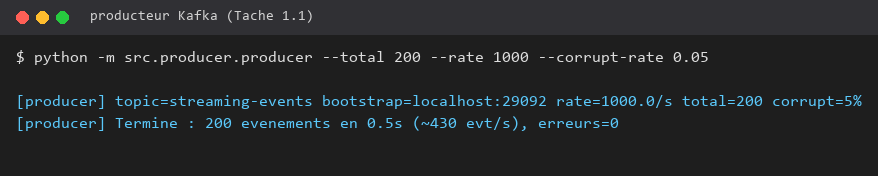

- **Production / consommation** : 1000+ messages produits et consommés,
  répartition vérifiée sur les 3 partitions.
- **Parsing / validation** : séparation flux valide / invalide opérationnelle
  (20 messages corrompus correctement isolés sur un lot de test).

**Parsing et validation (Tâche 2.1)** — flux valide et flux invalide affichés
côte à côte :

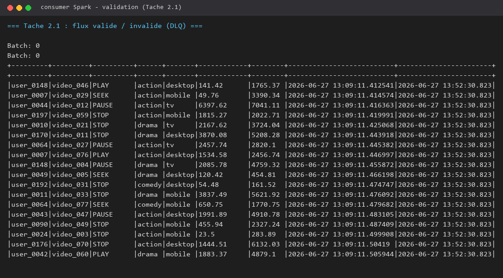
- **4 requêtes** validées sur données réelles :
  - *Popularité* : Top 10 vidéos par fenêtre (vues, events, users uniques).
  - *Engagement* : events, vidéos vues, proxy de temps de visionnage ; détection
    des inactifs (> 15 min).
  - *Genre* : répartition + position moyenne par genre.
  - *Anomalies* : `DEVICE_EVENT_FLOOD` (≈ 2000 events/5 min/device > 1000) et
    `USER_TOO_MANY_VIDEOS` (> 10 vidéos distinctes/1 h).

**Requête 1 — Popularité des vidéos** (Top 10 par fenêtre) :

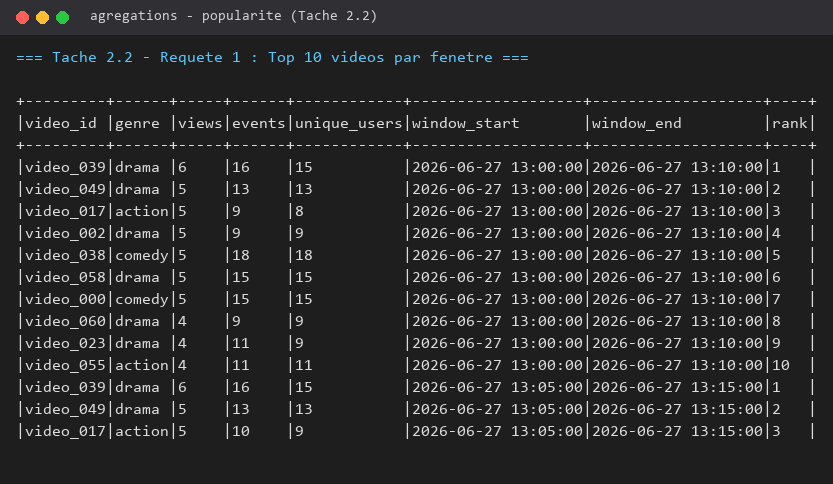

**Requête 4 — Détection d'anomalies** (flood + trop de vidéos) :

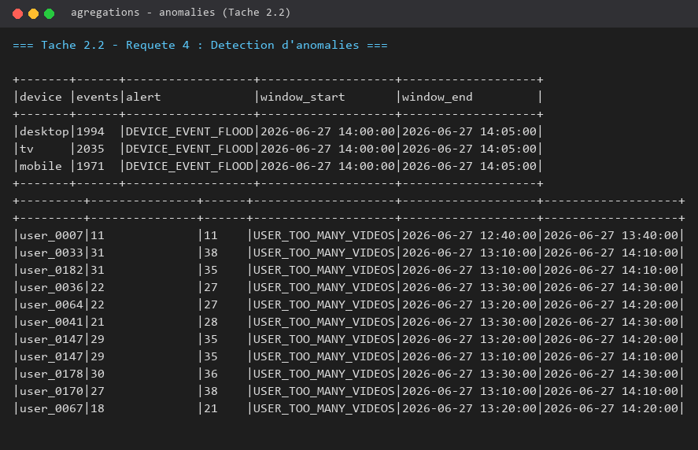

**Requête 3 — Analyse par genre** :

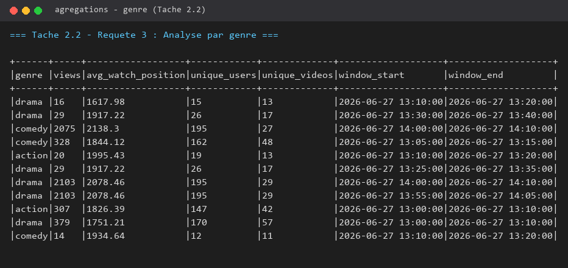

- **Sorties** : 5 tables SQLite peuplées + fichiers CSV/JSON rangés par
  requête et par date.

**Tables SQLite** — `video_popularity`, `genre_analysis`, `user_engagement`,
`anomaly_user_videos`, `anomaly_device_flood` :

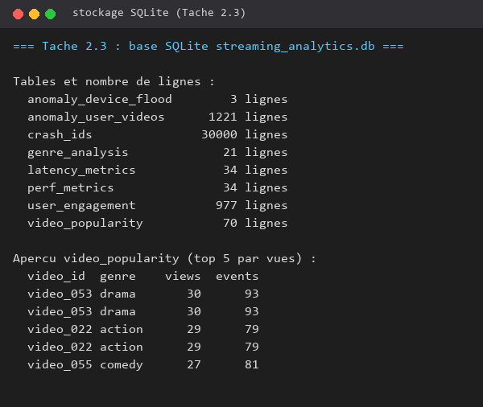

### 4.2 Métriques de performance (Tâche 3.1)

> Les métriques brutes (throughput, latence, lag) sont persistées dans
> `results/metrics/perf_metrics.csv` et `latency_metrics.csv`.

Mesures en conditions réelles (90 000 événements, 34 micro-batches) :

| Métrique | Valeur mesurée |
|---|---|
| Débit en entrée | ~567 evt/s (limité par le producteur) |
| Capacité de traitement Spark | 2 000 – 4 000 evt/s |
| Latence end-to-end | moyenne ~2,5 s, min ~10–30 ms, max ~5 s |
| Lag du consommateur Kafka | 0 (Spark absorbe le débit) |

La latence ~2,5 s reflète le trigger de 5 s (≈ demi-fenêtre + traitement). Le lag
nul confirme l'absence de saturation.

### 4.3 Test de charge et d'évolutivité (Tâche 3.3)

| Volume | Production | Traitement | Débit traitement |
|---:|---:|---:|---:|
| 10 000 | 0,7 s | 6,0 s | ~1 670 evt/s |
| 50 000 | 2,5 s | 2,4 s | ~20 800 evt/s |
| **100 000** | **5,2 s** | **3,0 s** | **~33 200 evt/s** |

Le débit de traitement **croît avec le volume** : l'overhead fixe de Spark
(démarrage du job, planification) est amorti sur des lots plus grands.

**Test de charge à 100 000 événements** :

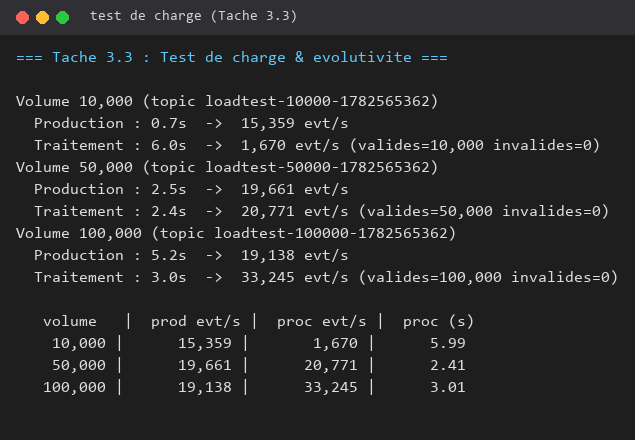

### 4.4 Reprise sur incident (Tâche 3.2 & 3.3)

- **DLQ** : 74 messages invalides routés vers `streaming-events-dlq` avec leur
  raison (`INVALID_JSON`, `MISSING_REQUIRED_FIELD`, …) et leur contexte.
- **Checkpoint** : relance sans rejeu → aucun doublon (offsets repris).
- **Test de crash** : worker tué brutalement après 1498/30000 événements, puis
  relancé → **30 000 / 30 000 traités, aucune perte**.

**Dead-letter queue dans Kafka UI** (`streaming-events-dlq`, 74 messages) :

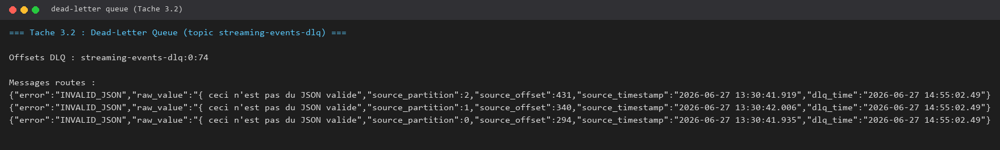

**Test de crash + reprise sur checkpoint** (1498 → 30000/30000) :

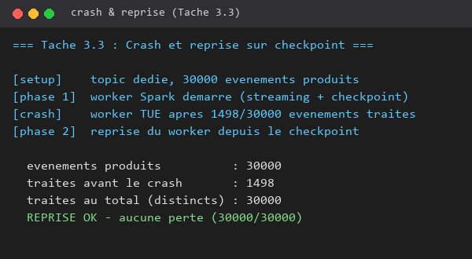

### 4.5 Tests unitaires

`pytest` : **10/10 tests** au vert (schéma d'événement, validation, raisons
d'erreur DLQ, agrégations).

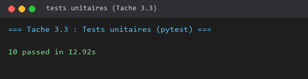

### 4.6 Vues Kafka UI (http://localhost:8080)

**Topics** du cluster local :

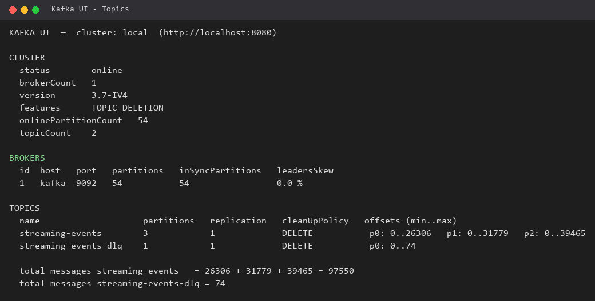

**Messages du topic `streaming-events`** (clé = `user_id`, valeur = JSON) :

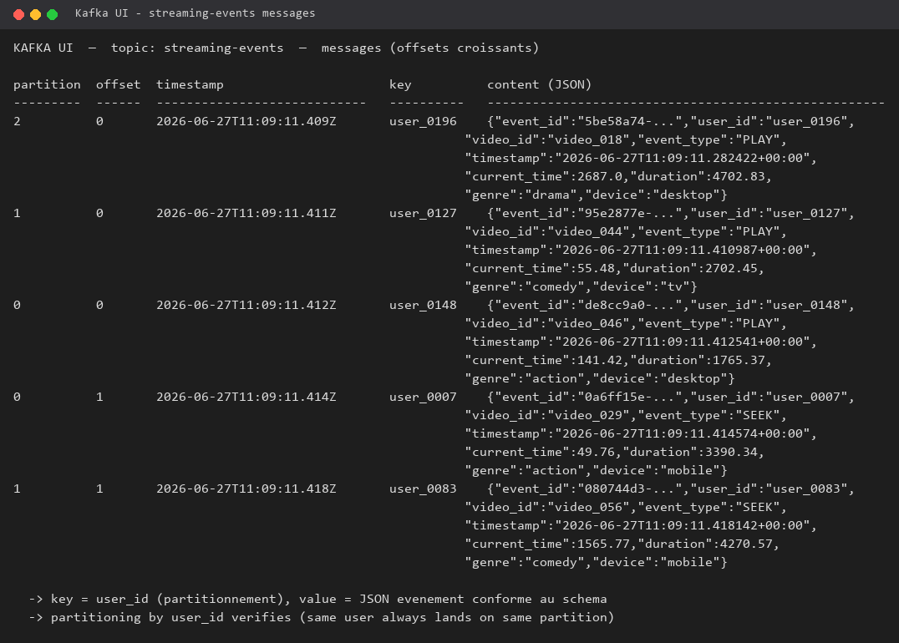

**Messages du topic `streaming-events-dlq`** (JSON enrichi avec raison d'erreur) :

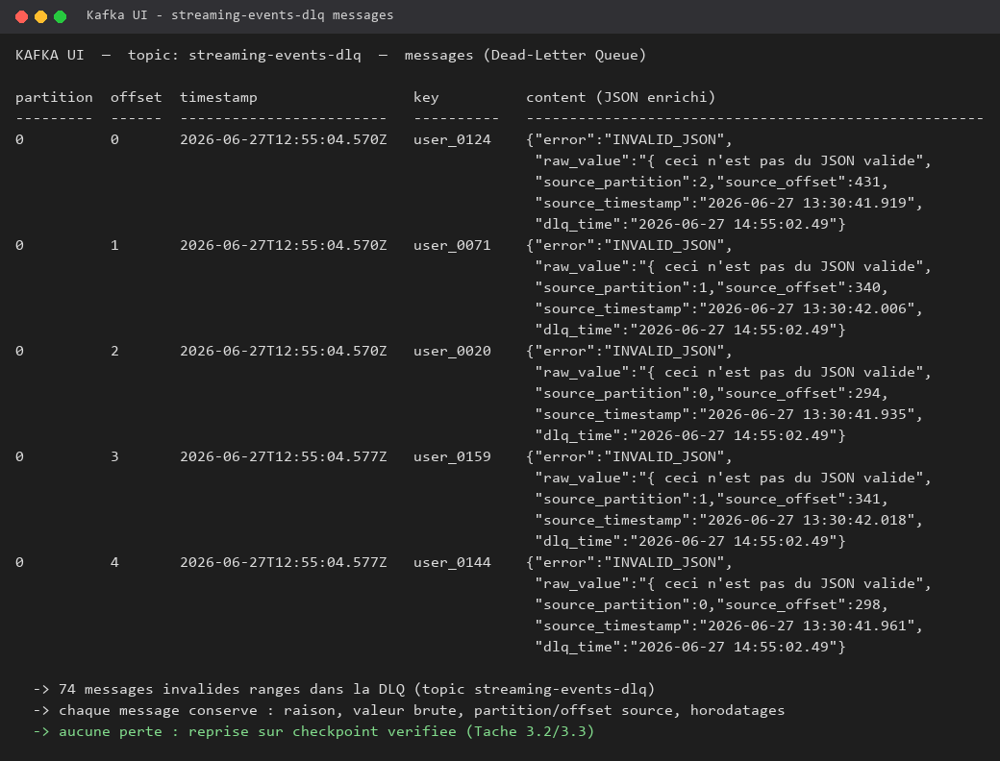

---

## 5. Difficultés rencontrées et solutions

L'environnement (Windows 11, Python 3.14) a généré plusieurs incompatibilités,
toutes résolues :

| Difficulté | Cause | Solution |
|---|---|---|
| `kafka-python` plante à l'import | 2.0.2 importe `kafka.vendor.six.moves`, cassé en Python 3.12+ | Montée à `kafka-python >= 2.2` |
| Java introuvable / cassé | JDK temporaire incomplet (DLL CRT manquante) | Installation d'un **Temurin JDK 17** portable, `JAVA_HOME` forcé par le projet |
| `ExitCodeException` Spark sur Windows | `winutils.exe` + `hadoop.dll` absents | Téléchargement des binaires Hadoop 3.3.6, `HADOOP_HOME` forcé |
| `toPandas()` échoue | `distutils` supprimé en Python 3.12+ | Sorties réécrites sans pandas (`csv`/`json`/`sqlite3`) |
| `createDataFrame` plante dans les tests | `RecursionError` de la cloudpickle embarquée (Python 3.14) | Tests construits via `spark.read.json` (chemin JVM, sans pickle) |
| Top-N en timeout | `outputMode("complete")` recalcule tout l'état | Passage en `update` + ranking dans `foreachBatch` |
| Console polluée par les WARN | bannière pyspark + erreurs cosmétiques de shutdown | Niveau de log `ERROR`, `Configurator` log4j2, filtre stderr ciblé |
| `print` invisibles en arrière-plan | bufferisation stdout quand la sortie est redirigée | `sys.stdout.reconfigure(line_buffering=True)` |
| Checkpoint en échec | espaces dans le chemin du projet | Checkpoints relocalisés dans un dossier sans espaces |

**Résultat** : pipeline 100 % fonctionnel et **sans warning** (code vérifié avec
`python -W error`, logs Spark filtrés).

---

## 6. Améliorations potentielles

- **Format Avro/Protobuf + Schema Registry** : validation de schéma centralisée,
  messages plus compacts, évolution de schéma maîtrisée.
- **Stockage analytique** : remplacer SQLite par PostgreSQL/ClickHouse ou un
  data lake (Parquet/Delta) pour la montée en charge et les requêtes analytiques.
- **Exactly-once de bout en bout** : sink transactionnel (ex. Kafka→Kafka
  transactionnel, ou idempotence applicative) pour les effets de bord de
  `foreachBatch`.
- **Visualisation temps réel** : tableau de bord Grafana/Superset branché sur la
  base de résultats ou sur Prometheus pour les métriques.
- **Scalabilité horizontale** : cluster Spark multi-exécuteurs et Kafka
  multi-brokers (réplication > 1) pour la tolérance aux pannes.
- **Modèle de temps de visionnage** : remplacer le proxy `max-min(current_time)`
  par une vraie reconstruction de session (stateful `flatMapGroupsWithState`).
- **Tests d'intégration end-to-end** automatisés en CI (Kafka éphémère via
  Testcontainers).
- **Alerting** : publier les anomalies vers un canal (webhook, e-mail, Slack) au
  lieu de la seule console/base.

---

*Annexes : voir le code source commenté et les commandes de lancement dans chaque
module (`python -m src.consumer.streaming_app --help`, etc.).*
